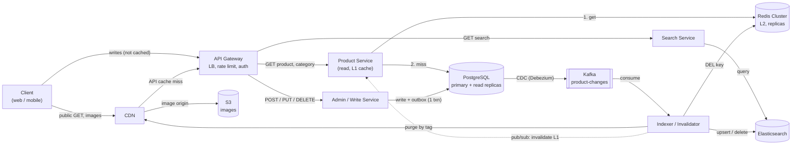
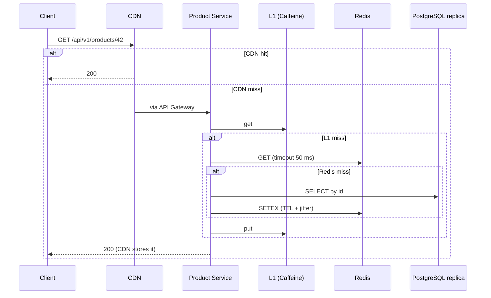

# Product Catalog: System Design (T5)

Design of the backend for an online store's product catalog: product cards, categories and search with filters.

| | |
|---|---|
| **Read load** | ~10,000 RPS (peak assumed 3x) |
| **Write load** | ~20 RPS |
| **Data** | 1M products (~2 GB metadata, ~1 TB images) |
| **Latency target** | p99 < 80 ms |
| **Consistency** | Eventual (seconds) |
| **Availability** | High (multi-AZ) |

This repository contains the design only (documents, schema, API contract and diagram). There is no application code.

## Contents

- [The idea in one minute](#the-idea-in-one-minute)
- [Architecture](#architecture)
- [Key numbers](#key-numbers)
- [Key decisions](#key-decisions)
- [Read path and write path](#read-path-and-write-path)
- [Documentation](#documentation)
- [Repository layout](#repository-layout)
- [Assumptions and known limitations](#assumptions-and-known-limitations)

## The idea in one minute

The catalog is read about 500 times more often than it is written, and the whole data set is small (~2 GB). So the design is built around **not touching the database**:

1. **Reads** pass through three cache levels: CDN, an in-process L1 cache (Caffeine) and a shared Redis Cluster. Only about 5% of requests reach PostgreSQL.
2. **Writes** are one short PostgreSQL transaction (guarded by a `version` column and an `Idempotency-Key`) that also writes an **outbox** row.
3. **Synchronisation:** Debezium (CDC) publishes the outbox to Kafka; an idempotent Indexer updates Elasticsearch, Redis, L1 and the CDN.
4. **Search** is a separate Elasticsearch index, because B-trees cannot serve text search and multi-filter queries.
5. **Resilience:** deadlines, a 50 ms Redis timeout, bounded queues, semaphores, load shedding and retries in a single layer keep the system degrading gracefully instead of collapsing.

## Architecture



An editable version is in [`diagrams/product-catalog.excalidraw`](diagrams/product-catalog.excalidraw); open it at <https://excalidraw.com> (menu: Open).

## Key numbers

| Quantity | Value | How |
|---|---|---|
| Read : write | 500 : 1 | 10,000 / 20 |
| Product size | ~2 KB | sum of field sizes (2,051 B) |
| Catalog | ~2 GB | 1M x 2 KB, fits in RAM |
| Images | ~1 TB | 1M x 5 x 200 KB, in S3 + CDN |
| DB load at 95% hit ratio | ~500 RPS (peak ~1,500) | 10,000 x 5% |
| Mean latency at 95% hits | ~1 ms | 0.95 x 0.5 + 0.05 x 10 |
| DB queries in flight | ~5 with cache, ~100 without | Little's Law, 500 x 0.010 vs 10,000 x 0.010 |
| Worst-case read path | ~73 ms | Redis times out at 50 ms, then DB; budget is 80 ms |

Details: [docs/04-capacity-estimation.md](docs/04-capacity-estimation.md).

## Key decisions

| Decision | Reason |
|---|---|
| CDN + L1 + Redis in front of PostgreSQL | 500:1 reads; data fits in memory |
| Cache-aside, `DEL` on write, TTL + jitter | Simple, robust to Redis outages, bounded staleness |
| PostgreSQL as source of truth, `jsonb` for attributes | Small relational data, constraints, transactions |
| No sharding | ~2 GB fits one PostgreSQL; caches and replicas carry reads |
| Elasticsearch for search | B-trees cannot do text search or facets |
| Outbox + CDC + Kafka | Atomic, avoids dual write, no network call in a transaction |
| `version` + `If-Match` (412) | Lost-update protection |
| `Idempotency-Key` on `POST` | Safe retries after timeouts |
| Cursor pagination | Constant cost for deep pages |
| Deadlines, timeouts, shedding, single-layer retries | Degrade gracefully under failure |

Full list with context and consequences: [docs/10-decisions.md](docs/10-decisions.md).

## Read path and write path



On a write, Write Service updates PostgreSQL and the outbox in one transaction; CDC and Kafka then drive Elasticsearch, Redis, L1 and the CDN. The full sequence diagrams are in [docs/05-architecture.md](docs/05-architecture.md).

## Documentation

| # | Document | Contents |
|---|---|---|
| 1 | [Requirements](docs/01-requirements.md) | FR, NFR, out of scope, assumptions, acceptance criteria |
| 2 | [Data model](docs/02-data-model.md) | Entities, field sizes, indexes, layers |
| 3 | [API design](docs/03-api.md) | Endpoints, pagination, `ETag`/`If-Match`, idempotency, caching headers |
| 4 | [Capacity estimation](docs/04-capacity-estimation.md) | Traffic, storage, hit-ratio table, Little's Law, latency budget |
| 5 | [Architecture](docs/05-architecture.md) | Components, read/write/search/image paths, staleness model |
| 6 | [Caching](docs/06-caching.md) | Layers, cache-aside, TTL, invalidation, stampede, configuration |
| 7 | [Search and synchronisation](docs/07-search-and-sync.md) | Elasticsearch, outbox, CDC, Kafka, reindexing |
| 8 | [Resilience](docs/08-resilience.md) | Failure matrix, timeouts, retries, load shedding, degradation |
| 9 | [Scaling and operations](docs/09-scaling-and-operations.md) | Scaling per tier, metrics, alerts, load test plan, runbooks |
| 10 | [Decisions and trade-offs](docs/10-decisions.md) | ADRs and known limitations |
| 11 | [Glossary](docs/11-glossary.md) | Terms explained briefly |
| 12 | [Defence guide](docs/12-defense-qa.md) | One-minute pitch, likely questions, numbers to remember |
| 13 | [Course concept map](docs/13-lecture-map.md) | Lecture concepts and where they are applied |

## Repository layout

```
.
├── README.md
├── docs/                       design documentation (13 documents)
├── db/schema.sql               PostgreSQL DDL, indexes, reference queries
├── api/openapi.yaml            OpenAPI 3.0 contract of the public API
└── diagrams/
    └── product-catalog.excalidraw   editable architecture diagram
```

## Assumptions and known limitations

- Peak traffic is assumed to be 3x the average; index sizes, instance counts and the latency budget are estimates to be confirmed by the load test in [docs/09-scaling-and-operations.md](docs/09-scaling-and-operations.md).
- A 95% cache hit ratio assumes a skewed (Zipf-like) request distribution.
- Roles are `admin` and `seller`, but there is no `seller_id` column, so seller-level ownership checks are out of scope.
- `/categories/{id}/products` lists direct members only; subtrees are browsed through `/search?category_id=`.
- A purge cannot reach browsers, so a price on a card can be up to `max-age` (60 s) old there; purchase flows must re-check the price.
- Outbox, CDC, Kafka, replication and circuit breakers are standard practice here and are scheduled for later weeks of the course; verify the details against those lectures.

## Course context

Assignment T5 of *Backend for Highloaded Environment* (Kazakh-British Technical University, Fall 2026). Concepts from lectures 3-6 (REST and idempotency, concurrency, caching, databases) are mapped to the design in [docs/13-lecture-map.md](docs/13-lecture-map.md).
