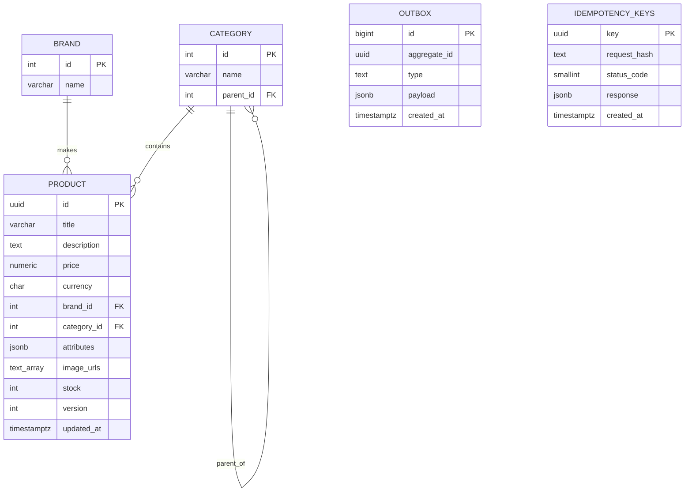

# 2. Data model

PostgreSQL is the **single source of truth**. Redis, the in-process L1 cache, Elasticsearch and the CDN hold derived copies that are updated or invalidated from change events.

Full DDL: [`db/schema.sql`](../db/schema.sql).

## 2.1 Entity-relationship diagram



`OUTBOX` and `IDEMPOTENCY_KEYS` are technical tables with no foreign keys: `outbox.aggregate_id` refers to a product id by value, because the outbox row must survive the deletion of the product it describes.

## 2.2 Product

| Field | Type | Size | Purpose |
|---|---|---|---|
| `id` | uuid | 16 B | Globally unique id, generated by any node, safe to expose in URLs |
| `title` | varchar(200) | <= 200 B | Name; also indexed for text search |
| `description` | text | ~1 KB | Full description |
| `price` | numeric(12,2) | 8 B | Exact decimal. Never `float` for money |
| `currency` | char(3) | 3 B | ISO 4217 code, e.g. `KZT` |
| `brand_id` | int FK | 4 B | Reference to `brands` |
| `category_id` | int FK | 4 B | Reference to `categories` |
| `attributes` | jsonb | ~500 B | Heterogeneous specs (phone: `ram`, `storage`; shirt: `size`, `material`) |
| `image_urls` | text[] | ~300 B | CDN URLs only (about 5 URLs x ~60 B). Files are in S3 |
| `stock` | int | 4 B | Units available; `CHECK (stock >= 0)` |
| `version` | int | 4 B | Incremented on every change; optimistic lock and Elasticsearch external version |
| `updated_at` | timestamptz | 8 B | Last change time |

Sum: 16 + 200 + 1000 + 8 + 3 + 4 + 4 + 500 + 300 + 4 + 4 + 8 = **2,051 B, about 2 KB**.
1,000,000 rows x 2 KB = **~2 GB** (plus ~1 GB of indexes). This is why sharding is not needed and why the whole catalog fits in Redis memory.

### Design notes

- **`uuid` primary key.** Random UUIDs scatter inserts across the B-tree index. At 20 writes/s this is harmless; a time-ordered UUID (v7) is a drop-in improvement.
- **`numeric` for price.** Binary floating point cannot represent 0.1 exactly; money must be exact. The API transports price as a decimal string for the same reason.
- **`jsonb` for attributes.** One column instead of hundreds of sparse ones. The `GIN (jsonb_path_ops)` index serves `attributes @> '{"storage":"128GB"}'`. PostgreSQL does not validate the shape, so the application validates attributes before writing.
- **Images are not stored in the database.** About 1 TB of files lives in S3; the row stores only URLs. The stored URL is the CDN URL, so the origin can change without rewriting rows.
- **`version`.** It is a counter, not a timestamp, so concurrent updates are detected exactly. It is also copied into the Redis value and the Elasticsearch document so that stale writes can be rejected.

## 2.3 Category

| Field | Type | Size | Purpose |
|---|---|---|---|
| `id` | int | 4 B | Identifier |
| `name` | varchar(100) | <= 100 B | Display name |
| `parent_id` | int FK (self) | 4 B | Parent category, `NULL` for roots |

Example tree:

```
1 Electronics            parent_id = NULL
2 |- Phones              parent_id = 1
3 |   `- Smartphones     parent_id = 2
4 `- Laptops             parent_id = 1
```

Categories are few and rarely change. Product Service keeps the whole tree in process memory, refreshed about once a minute.

`GET /categories/{id}/products` returns products **directly** in that category (served by the `(category_id, price, id)` index). Browsing a whole subtree is done through `GET /search?category_id=...`, because Elasticsearch documents carry the list of ancestor category ids.

## 2.4 Technical tables

### outbox

One row per product change, written in the **same transaction** as the change itself. See [docs/07-search-and-sync.md](07-search-and-sync.md).

| Field | Purpose |
|---|---|
| `id` | Monotonic event number |
| `aggregate_id` | Product id; becomes the Kafka message key (per-product ordering) |
| `type` | `product_created`, `product_updated`, `product_deleted` |
| `payload` | Event body, always containing `id` and `version` |
| `created_at` | Creation time; used for cleanup and lag measurement |

### idempotency_keys

Makes `POST /products` safe to retry. See [docs/03-api.md](03-api.md#35-idempotency).

| Field | Purpose |
|---|---|
| `key` | Client-generated UUID. The primary key is the unique constraint that settles races |
| `request_hash` | Hash of the request body; same key with a different body is rejected |
| `status_code`, `response` | The stored result, replayed on retry. `NULL` while the first request is running |
| `created_at` | Rows older than 24 hours are deleted |

## 2.5 Indexes

| Index | Serves | Why |
|---|---|---|
| `PRIMARY KEY (id)` | `GET /products/{id}` | Point lookup, 3 B-tree levels for 1M rows |
| `(category_id, price, id) INCLUDE (title)` | Category list | Equality column first, then the sort column; `id` makes the cursor unique; `INCLUDE` allows an Index Only Scan |
| `GIN (attributes jsonb_path_ops)` | Attribute containment | Avoids a sequential scan over jsonb |
| `(brand_id)` | Foreign key, brand lookups | Keeps brand deletes and joins cheap |

Fan-out of a PostgreSQL B-tree page is about 300, so 300^3 = 27 million rows fit in three levels.
Every index adds work to each write. At 20 writes/s this cost is negligible, but unused indexes (`pg_stat_user_indexes.idx_scan = 0`) should still be dropped.

## 2.6 The model in every layer

| Layer | Representation |
|---|---|
| PostgreSQL | Full row (source of truth) |
| Redis (L2) | Key `product:{id}` -> JSON of the product, ~2 KB, TTL 5-15 min + jitter |
| L1 (Caffeine) | Same object in process memory, TTL ~10 s |
| Elasticsearch | Search subset: `title`, `description`, `brand`, `category_ids`, `price`, `attributes`, `version` |
| S3 / CDN | Image files |
| API response | JSON with `version` and an `ETag` header |

## 2.7 Example row

```json
{
  "id": "550e8400-e29b-41d4-a716-446655440000",
  "title": "iPhone 15 128GB",
  "description": "6.1-inch display, A16 chip...",
  "price": "450000.00",
  "currency": "KZT",
  "brand_id": 12,
  "category_id": 3,
  "attributes": { "ram": "6GB", "storage": "128GB", "color": "black" },
  "image_urls": [
    "https://cdn.shop.example/p/550e8400/1.jpg",
    "https://cdn.shop.example/p/550e8400/2.jpg"
  ],
  "stock": 37,
  "version": 6,
  "updated_at": "2026-10-17T12:00:00Z"
}
```
