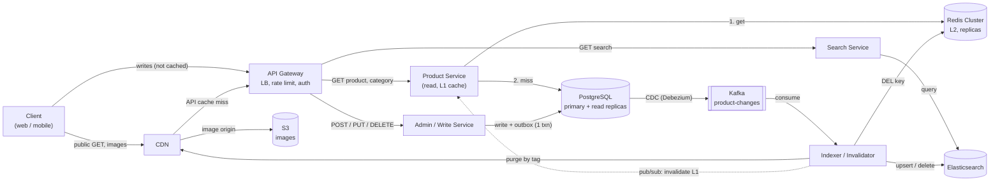
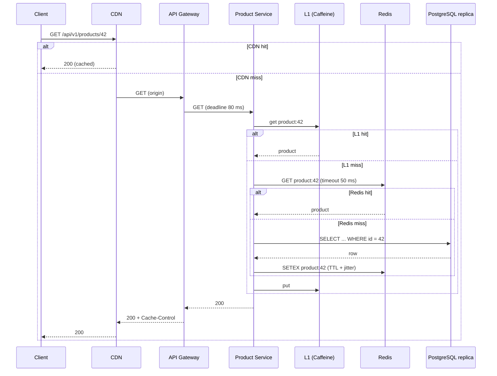
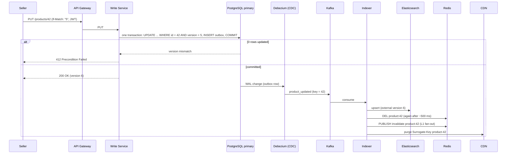

# 5. Architecture

## 5.1 High-level design

Editable diagram: [`diagrams/product-catalog.excalidraw`](../diagrams/product-catalog.excalidraw) (open it at <https://excalidraw.com>).

## 5.2 Components

| Component | Responsibility | State | Scales by |
|---|---|---|---|
| **CDN** | Edge cache for images and public GET responses; purge by `Surrogate-Key` | Cache only | Provider |
| **API Gateway / LB** | TLS, JWT check, rate limit (429), deadline start, routing, load balancing | Stateless | Instances |
| **Product Service** | Card and category reads. L1 (Caffeine) -> Redis -> PostgreSQL replica. Coalesces rebuilds | Stateless (L1 is disposable) | Instances |
| **Search Service** | Translates query parameters to Elasticsearch queries | Stateless | Instances |
| **Admin / Write Service** | Validation, authorisation, writes with `version` check, idempotency, outbox, presigned upload URLs | Stateless | Instances |
| **Redis Cluster** | L2 cache, locks for coalescing, idempotency fast path | Derived data | Shards + replicas |
| **PostgreSQL** | Source of truth (products, categories, brands, outbox, idempotency keys) | Durable | Read replicas |
| **Elasticsearch** | Text search and filters; eventually consistent copy | Derived data | Shards + replicas |
| **Kafka + Debezium** | Reliable transport of change events from the outbox | Durable log | Partitions, brokers |
| **Indexer / Invalidator** | Applies each event to Elasticsearch, Redis, L1 (pub/sub) and CDN | Stateless, idempotent | Consumers in a group |
| **S3** | Image files | Durable | Provider |

## 5.3 Read path: product card

A CDN miss never goes straight to PostgreSQL: it goes to our origin, which checks L1 and Redis first. Each layer shields the next one; roughly 5% of requests reach the database.

## 5.4 Write path: update a product

The service never calls Kafka, Elasticsearch or Redis inside the database transaction (Lecture 6: never call the network inside a transaction). It only writes rows; the outbox and CDC take care of delivery.

## 5.5 Search path

`GET /search` -> API Gateway -> Search Service -> Elasticsearch. Search results are not looked up in PostgreSQL. If Elasticsearch is down, search answers `503` with `Retry-After`, while cards and category lists keep working from the cache/PostgreSQL path.

## 5.6 Image path

Upload: the client receives a presigned URL from Write Service and uploads straight to S3. Read: product JSON contains CDN URLs; the browser fetches images from the CDN, which falls back to S3. Image bytes never pass through the services (see [API 3.8](03-api.md#38-image-upload)).

## 5.7 Where each copy of the data can be stale

| Copy | Maximum staleness | How it is refreshed |
|---|---|---|
| Browser | `max-age` (60 s) | Expiry (a purge cannot reach browsers) |
| CDN | `s-maxage` (600 s) unless purged | Purge by `Surrogate-Key` from the Indexer |
| L1 (in process) | ~10 s TTL | Pub/sub invalidation; TTL is the backstop |
| Redis | TTL 5-15 min (stock/price 10-60 s) | `DEL` on change + delayed second `DEL`; TTL is the backstop |
| Elasticsearch | Event lag (ms to seconds) | Indexer upsert with external version |
| PostgreSQL replica | Replication lag (ms) | Asynchronous replication |

This is the system's **eventual consistency** model: bounded, observable and acceptable for a catalog.

## 5.8 Protocol choices (Lecture 3 boundary rule)

- **Client <-> gateway: REST/JSON.** We own neither the client nor its build, so be boring and cacheable.
- **Gateway <-> services:** REST is sufficient at this load. gRPC would be a valid internal choice (compiled contract, smaller payloads, deadlines propagate automatically), but it needs L7 load balancing because one HTTP/2 connection carries many calls. Not required for 10,000 RPS.
- **Events:** JSON in Kafka for readability. Avro with a schema registry is the usual upgrade when many consumers appear.
