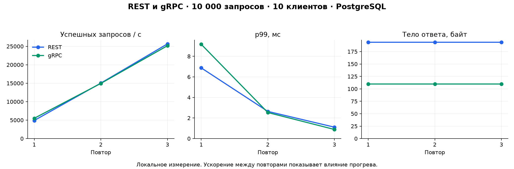

# Реальное сравнение REST и gRPC

## Условия

Дата: 30 октября 2026 года.
Windows amd64, JDK 22.0.2, локальная PostgreSQL **17rc1** из существующей установки.
Код скомпилирован для Java 21. Приложение, клиент и база работают на одной машине,
приложение и клиент — отдельные JVM. Пул БД: 10 соединений.
Использована отдельная база catalog_benchmark, без прикладного кэша.

Сценарий: GET одного товара; 10000 запросов, 10 клиентов, 3 повтора на протокол.
Всего 60000 измеренных и 6000 прогревочных GET.
Перед каждым повтором — 1000 последовательных запросов прогрева.
Порядок: REST/gRPC, gRPC/REST, REST/gRPC.
Повторы выключены; клиентский тайм-аут 2 секунды.

[CSV каждого запроса](../benchmark/results/postgresql-10000-10/raw.csv) ·
[Сводный CSV](../benchmark/results/postgresql-10000-10/summary.csv) ·
[Окружение](../benchmark/results/postgresql-10000-10/environment.txt)

## Результаты

| Протокол | Повтор | RPS | p50, мс | p95, мс | p99, мс | Payload, байт | Ошибки |
|---|---:|---:|---:|---:|---:|---:|---:|
| REST | 1 | 4 897 | 1,668 | 4,501 | 6,875 | 194 | 0 |
| gRPC | 1 | 5 498 | 1,283 | 4,178 | 9,167 | 110 | 0 |
| REST | 2 | 15 030 | 0,510 | 1,438 | 2,643 | 194 | 0 |
| gRPC | 2 | 14 950 | 0,552 | 1,322 | 2,533 | 110 | 0 |
| REST | 3 | 25 662 | 0,332 | 0,717 | 1,109 | 194 | 0 |
| gRPC | 3 | 25 159 | 0,364 | 0,682 | 0,886 | 110 | 0 |



## Как трактовать

Protobuf-ответ для этого товара занимает 110 байт против 194 у JSON:
примерно на 43,3% меньше. Здесь посчитано тело сообщения, без заголовков,
HTTP/2 framing и сетевых пакетов.

Результаты заметно ускоряются от первого повтора к третьему у обоих протоколов.
Это указывает на сильное влияние прогрева JVM/JIT и окружения;
1000 прогревочных запросов недостаточно для стабильного режима на этой машине.
Из-за коротких прогонов и такого разброса нельзя уверенно объявить
один протокол быстрее другого. Сохранены все прогоны, включая первый.

Оба API корректно отвечали в выбранном локальном сценарии.
Достижение целевых 10000 RPS и p99 < 80 мс в отдельных прогонах
**не доказывает SLA SIS 1**: нет длительной нагрузки, удалённой сети,
большого набора товаров, TLS, авторизации и смеси чтений с записями.

Для устойчивого вывода нужен более длительный прогрев, затем несколько
длинных прогонов с контролем CPU/GC, большим набором товаров и реальной сетью.
Тесты 1000/1, 50000/50 и остальные комбинации этим отчётом не заявлены;
клиент позволяет запустить их отдельно.

## Повторение и график

Команда запуска описана в [benchmark/README.md](../benchmark/README.md).
Сохраните результаты нового запуска в новую папку.
График строится обычным Python + matplotlib:

```powershell
python -m pip install matplotlib
python benchmark/plot.py benchmark/results/my-run/summary.csv docs/my-benchmark-chart.png
```
